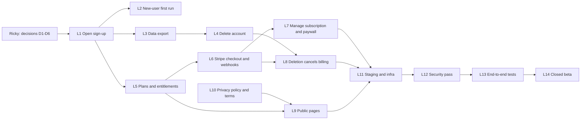

# Tight Arse — Multi-user and Launch Plan

**Owner:** Ricky · **Revised:** 15 Nov 2026, after the codebase audit (`docs/multi-user-audit.md`)
**Scope:** open sign-up, plans and subscriptions, public pages, privacy policy and terms, data export, account deletion, subscription management.
**Not in scope:** a native iOS app and Apple in-app purchase. The subscription table leaves room for a second source; nobody builds it here.

Every agent also follows `AGENTS.md`. Where this plan and `AGENTS.md` disagree, this plan wins only on the points listed in the audit's section 5, and L1 updates `AGENTS.md` so they stop disagreeing.

## What the audit changed

The first draft of this plan assumed a single-user schema. That was wrong: `UserId`, the global query filter, the write guard and the cross-user attack tests already exist, and hosting is already Basic SQL with one warm replica. Two whole tasks (adding `UserId` everywhere, building tenant isolation) are gone. The real work is the front door, then the features that never existed.

## 1. Order

| Phase | Tasks | Parallel? | Blocked on |
|---|---|---|---|
| 0 | D1–D6 (Ricky) · L10 drafts can start | — | nothing |
| 1 | **L1** | alone | D1 |
| 2 | **L2** · **L3 → L4** · **L5** | three tracks side by side; L4 after L3 (both edit the Account part of Settings) | L1 merged |
| 3 | **L6** → **L7** and **L8** | L7 beside L8 | L5 (L8 also needs L4) |
| any time after L5 | **L9** | yes | D3, D4, L10 drafts |
| 4 | **L11 → L12 → L13 → L14** | in order | everything above |

**Rule for every PR:** `TenantIsolationTests` stays green, and any new `/api` route is added to it with an attack or a stated reason. The guard test enforces this; do not weaken it.

## 2. Decisions for Ricky (Phase 0)

| # | Decision | Recommendation | Why |
|---|---|---|---|
| D1 | Sign-in providers | **Decided 15 Nov: Google now, Apple added before the App Store release, Microsoft removed.** Recommended build: connect to each provider directly with the OpenID Connect handler the app already uses. No Entra External ID, no passwords, no email sign-up. | No one signs in to a budgeting app with Microsoft. Going direct means no extra tenant, no Microsoft-hosted sign-in page and no identity directory to clean up on deletion. Apple requires an app that offers Google sign-in to offer an equivalent private option; Sign in with Apple satisfies that. Open point: email sign-up is left out unless Ricky asks for it. |
| D2 | Billing | **Stripe Checkout + Stripe Customer Portal** | Hosted pages, so no card form and no CSP change. The Portal gives cancel, plan switch, card update and invoices for free. |
| D3 | Plans | **Free + Premium at A$3.99/month or A$29.99/year, 14-day trial.** Free: everything for the current cycle, up to 6 categories, export, delete. Premium: unlimited categories, cross-cycle trend chart and past-cycle reports beyond the last one. | Export and delete stay free: they are trust features. Confirm the exact split; L5 builds whatever this row says. |
| D4 | Where public pages live | **Inside this app** as signed-out routes (`/`, `/pricing`, `/privacy`, `/terms`) | *Changed from the first draft*, which said a separate Astro site. One deploy, the existing design system, same origin, no second repo. Trade-off: weaker SEO than static HTML. If search traffic matters later, move them to a static site then. |
| D5 | Account deletion | **Immediate hard delete after typing a confirmation** | Backups age out with Azure SQL Basic's 7-day point-in-time restore; the privacy policy says so. |
| D6 | Staging | **Add a `staging` environment** (`bgt-staging-*`: Container App, Basic DB, Stripe test keys, its own Google OAuth client) | About A$15/month. Prod will hold other people's financial data; migrations and webhooks need somewhere else to fail first. |

Your own account: after L1, sign in once through the new provider and L1's one-off script re-points your existing `User` row at the new subject id, so your data stays.

## 3. Tasks

Each has **Depends on · Owns · Build · Done when**. "Owns" is the boundary: anything outside it gets a note in `docs/build-log.md` and a stop, not an edit.

### L1 — Open sign-up
- **Depends on:** D1 (Ricky creates a Google OAuth client and supplies its id and secret as config)
- **Owns:** `src/Budget.Application/Users/` (`Login`, `RealUsers`, `AllowedOids`), `src/Budget.Domain/Users/User.cs`, `src/Budget.Api/Auth/`, a migration, `src/web/src/features/auth/`, `infra` auth parameters, `AGENTS.md` and `docs/solution-design.md` (the points in audit section 5 only), matching tests
- **Build:**
  - Replace the Entra handler with Google (`https://accounts.google.com`, scopes `openid email profile`). Remove `/auth/login` for Microsoft, the Microsoft button and the `Entra:*` settings.
  - `User.ExternalId` becomes provider-qualified: `google:` now, `apple:` later. Sign-in is written as a list of providers so Apple is a second entry, not a rework. `GET /auth/options` reports which are on.
  - No account linking: the same person through Google and later Apple is two accounts. Say so in the build log; revisit when Apple lands.
  - `Login` provisions on first sign-in: unknown subject creates a `User` and returns its id. A concurrent duplicate loses on the unique index and re-reads.
  - Add `Email` to `User` (nullable, expand-only migration; filled from the token, may be absent or a relay address with Apple; never logged).
  - Remove the allowlist gate and the `migrate`-time `RealUsers` creation. Keep the demo exactly as it is.
  - One-off, idempotent re-link for Ricky's existing row (old Entra oid → his Google subject), run by `migrate` from config.
  - Sign-in screen: "Continue with Google" (Google's own button artwork and wording) plus the demo button. Ricky has decided this, so update `design-system/budget/MASTER.md` section 8 to name Google, and later Apple, in place of Microsoft.
  - Update `AGENTS.md` decision 4 and the "never created at request time" rule.
- **Done when:** a stranger can sign in with Google and land in onboarding; Microsoft sign-in is gone; Ricky's account still shows all his data; two fresh users in the API isolation suite cannot touch each other; `LoginTests`, `EntraSignInTests` and `RealUsersTests` are rewritten, not deleted.

### L1b — Sign in with Apple (later, before the App Store release)
- **Depends on:** L1, L4, Ricky's Apple Developer account
- **Owns:** `src/Budget.Api/Auth/`, sign-in screen, the deletion use case, tests
- **Build:** Apple as a second provider (`apple:`; the client secret is a signed JWT that expires and must be regenerated). Apple may hide the user's email and sends the name only on first sign-in. Account deletion revokes the Apple token.
- **Done when:** sign-in with Apple works on an iPhone; deleting the account revokes the token.

### L2 — New-user first run
- **Depends on:** L1
- **Owns:** `src/web/src/features/onboarding/`, `Users/Me.cs`, tests
- **Build:** on first run send the device's IANA time zone and a display name to `PATCH /api/me` before the first cycle is created (audit A5); default from the token's name. Empty states that made sense for one known user get a second look.
- **Done when:** a new user in `Australia/Perth` sees Perth's "today"; a Playwright onboarding spec covers it.

### L3 — Export my data
- **Depends on:** L1
- **Owns:** a new export use case in `Budget.Application/Users/`, `MeEndpoints.cs`, the Account part of `features/settings/`, tests
- **Build:** `GET /api/me/export` streams a ZIP: one CSV each for cycles, categories per cycle, transactions, plus one JSON of everything. ISO dates, plain decimals. Needs a connection (not an offline write). Rate-limited.
- **Done when:** a two-user test proves A's export holds none of B's rows; the route is in the isolation guard list; the CSV opens cleanly in Excel and Google Sheets.

### L4 — Delete my account
- **Depends on:** L3 (file overlap), D5
- **Owns:** a delete-account use case, `MeEndpoints.cs`, `IUserRepository` + `UserRepository`, an `IBilling.CancelForDeletionAsync` port with a **no-op** implementation, Account settings UI, tests
- **Build:** `DELETE /api/me` after a typed confirmation: cancel billing (port), `DeleteDataAsync`, delete the `User` row, sign out. (Google needs nothing more. When Apple is added, deletion must also revoke the user's Apple token; L1b owns that.) Each step safe to retry. Refused for the demo user.
- **Done when:** afterwards no table holds a row for that user; signing in again with the same Google account starts a fresh account; the demo cannot be deleted.

### L5 — Plans and entitlements
- **Depends on:** L1, D3
- **Owns:** a new `Budget.Domain/Subscriptions/` and `Budget.Application/Subscriptions/` folder, a migration, the gate calls in existing use cases, `MeDto`, locked-state UI, tests
- **Build:**
  - `Subscription` table (tenant table: `UserId`, query filter, added to `DeleteDataAsync`): `Source` (`stripe`; `apple` reserved), `ExternalId`, `Status`, `Plan`, `CurrentPeriodEnd`, `TrialEnd`, `CancelAtPeriodEnd`.
  - `Entitlements` use case computes the effective plan; limits from D3 live in one class. Enforced in Application, the way `DemoCaps` is; the UI only displays.
  - Downgrade never deletes: over-limit data becomes read-only.
  - `GET /api/me` reports the plan and limits so the SPA can draw locks.
- **Done when:** every gate is unit-tested on both plans; a downgraded user keeps all data.

### L6 — Stripe checkout and webhooks
- **Depends on:** L5, D2 (Ricky creates the Stripe account, products and prices in test mode)
- **Owns:** `Budget.Infrastructure` Stripe adapter, a billing endpoint file in `Budget.Api`, the real `IBilling`, config and secrets wiring, tests
- **Build:**
  - `POST /api/billing/checkout` returns a Checkout Session URL (monthly or annual, trial, customer linked to the user).
  - `POST /billing/webhook` outside `/api`: signature-verified, no session, no antiforgery, idempotent on event id, runs as the user the event names (own scoped `ICurrentUser`, like `JobUser`). Handles checkout completed, subscription created/updated/deleted, invoice payment failed.
  - Webhooks are the only thing that changes `Subscription`. The browser's return from Stripe changes nothing and lands on an SPA route (audit section 4).
  - Failed payment: `past_due`, short grace, then Free.
- **Done when:** with the Stripe CLI, trial → active → cancelled → expired each update the row; the same event twice changes nothing; a forged signature is refused.

### L7 — Manage subscription and paywall
- **Depends on:** L6
- **Owns:** Plan section of `features/settings/`, a new `features/billing/`, tests
- **Build:** Settings shows plan, renewal date, trial days left; "Manage subscription" opens the Stripe Customer Portal; a locked feature opens an upgrade sheet with both prices. All "needs a connection".
- **Done when:** upgrade, switch monthly ↔ annual, cancel and resubscribe all work in test mode and the screen follows once the webhook lands.

### L8 — Deletion cancels billing
- **Depends on:** L4, L6
- **Owns:** the Stripe implementation of `CancelForDeletionAsync`, tests
- **Done when:** deleting a Premium test user leaves no active subscription in Stripe, and a webhook arriving afterwards is ignored without error.

### L9 — Public pages
- **Depends on:** D3, D4, L10 drafts; reads plan limits from L5's one class
- **Owns:** a new `features/public/`, the signed-out routes in `App.tsx` / `SessionGate.tsx`, `vite.config.ts` only if the service worker needs it, tests
- **Build:** `/` (what it is, three features, screenshots, "Start free", "Try the demo"), `/pricing` (matches D3 exactly), `/privacy`, `/terms`. Design system rules apply in full. Page titles and Open Graph tags per route.
- **Done when:** all four render signed-out and offline-safe, links work, and pricing text is generated from the same numbers the server enforces.

### L10 — Privacy policy and terms (agent drafts, Ricky approves)
- **Depends on:** the audit, D1–D5
- **Owns:** `docs/legal/privacy.md`, `docs/legal/terms.md`
- **Build:** plain English. Privacy: what is collected (email, name, time zone, the budget data you type), where it lives (Azure, Australia East), who processes it (Microsoft, Stripe, Cloudflare), retention and backups, export and delete, contact. Terms: subscription, trial, cancellation, refunds, acceptable use, not financial advice. A table lists each claim beside the code that makes it true.
- **Done when:** Ricky has approved both. Drafts are not legal advice; a lawyer's review before taking money is worth the fee.

### L11 — Staging and infra
- **Depends on:** L7, L8, L9, D6
- **Owns:** `infra/`, `.github/workflows/`
- **Build:** `infra/parameters/staging.bicepparam`; `deploy.yml` goes to staging on push to `main`, prod on manual approval; Stripe and Google secrets as Container App secrets; alerts on webhook failures and 5xx; raise the budget alert for two environments.
- **Done when:** both environments deploy from Actions with `what-if` reviewed, and one point-in-time restore has been rehearsed on staging.

### L12 — Security pass
- **Depends on:** L11
- **Owns:** `docs/security-review.md`, small hardening fixes
- **Build:** review every new route for auth, antiforgery and rate limit; confirm no email or amount reaches a log; CSP unchanged or changed with its `HostTests` expectation; sign-up abuse limits (rate limit on first sign-in, cap on new accounts per address per day); dependency scan clean.
- **Done when:** the findings list is empty or each item is accepted by Ricky in writing.

### L13 — End-to-end tests
- **Depends on:** L12, and Ricky's call on audit B7 (how a second user signs in under test)
- **Owns:** `tests/e2e/`
- **Build:** one spec per new story: sign up, first run, hit a Free limit, upgrade with a Stripe test card, manage, cancel, export, delete. One two-browser spec proving user A never sees user B's data on screen.
- **Done when:** the suite passes against staging.

### L14 — Closed beta (Ricky)
Invite 5–15 people. Watch who is still logging in week four before fixing the price.

## 4. Prompt for each agent

> You are implementing **L\<N\> — \<title\>** in `budget-app`.
>
> Read `AGENTS.md`, then `docs/multi-user-launch-plan.md` and `docs/multi-user-audit.md` in full. Your spec is the L\<N\> section. Build what it says against the decisions in section 2.
>
> Change only what L\<N\>'s **Owns** line lists. If you need something outside it, append what and why to `docs/build-log.md` and stop for a decision.
>
> Work test-first in the lowest tier that can express the behaviour. Keep `TenantIsolationTests` green and add every new `/api` route to it. Finish with tests and lint passing, a PR against `main` that states what you built, what it depends on and any assumption this plan did not make for you, and the same summary appended to `docs/build-log.md`.

## 5. Only Ricky can do these

- [ ] Decide D1–D6
- [ ] Create a Google Cloud project, OAuth consent screen and two OAuth clients (staging, prod)
- [ ] Before the App Store release: Apple Developer account, a Services ID and key for Sign in with Apple
- [ ] Create the Stripe account, products and prices; later, switch on live mode
- [ ] A support email address on the domain
- [ ] Approve the privacy policy and terms (L10)
- [ ] Decide how a second user signs in under Playwright (audit B7)
- [ ] Recruit beta testers (L14)

## 6. Unattended run, started 15 Nov 2026

Ricky asked for the plan to be worked by agents while he is away. How that run is set up:

- **Integration branch `multi-user`.** Every task PR targets `multi-user`, not `main`, because `deploy.yml` deploys production on every push to `main` and production has no Google client yet. One final PR `multi-user` → `main` is left for Ricky.
- **Checks.** The agent workspace cannot restore NuGet packages or run Docker, so .NET builds and tests run only in GitHub CI on the PR. Web lint, tests and build run locally and in CI. A PR is merged into `multi-user` only when `ci / build`, `ci / web` and `ci / codeql` are green.
- **Decisions taken as recommended in section 2**, since Ricky had not ruled on them: D3 (Free with up to 6 categories; Premium A$3.99/month or A$29.99/year, 14-day trial), D4 (public pages inside the app), D5 (immediate hard delete). D1 is Ricky's: Google now, Apple later, no Microsoft. Google OAuth client id for local use: `47567868385-9h2n07u3ehvbactro1ctbr51bkffcit3.apps.googleusercontent.com` (not secret; the secret lives in user-secrets).
- **Changed since section 3 was written:** the paid product will be a native app, so L6–L8 are now Apple in-app purchase (and Google Play billing if Android goes first), not Stripe. L5 still builds the `Subscription` table and entitlements with `Source` left open.
- **In scope for this run:** L1, L2, L3, L4 (billing cancel stays a no-op port), L5, L9, L10 (drafts), L12 (review of what was built).
- **Parked, each needs something only Ricky has:** L1b (Apple Developer account), L6–L8 (store accounts and a native app), N1/N2 (decision D7, a Mac for iOS), L11 (Azure access), L13 (Docker to run Playwright), L14.
- Progress and anything needing a decision is logged in `docs/build-log.md`.
